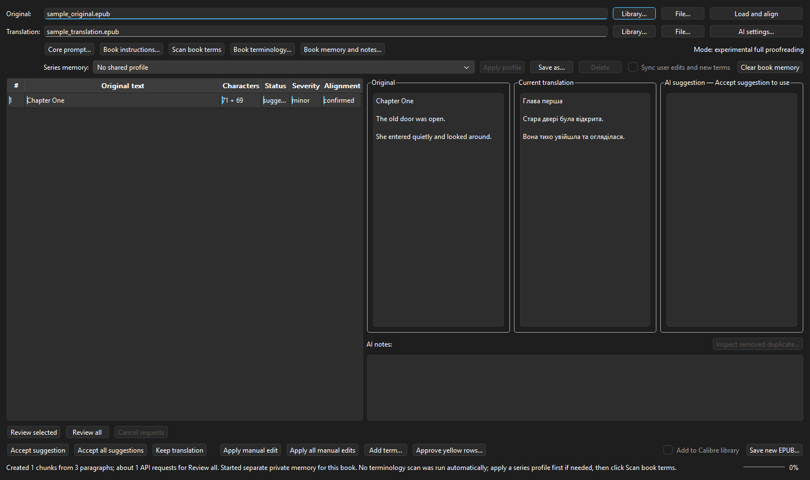

# Translation Proofreader for Calibre

Proofread an existing EPUB translation against its original, review AI suggestions side by side, and save a new EPUB. Translation Proofreader is a Calibre plugin for *human-supervised editing*, not a one-click book translator.

**Version:** 0.11.15 · **Requires:** Calibre 7.0+ · **Formats:** EPUB input and output · **License:** [GPL-3.0](LICENSE)

## Download and install

1. Download **Translation-Proofreader-0.11.15.zip** from the [latest release](../../releases/latest). Download the release asset, **not** GitHub's automatic “Source code” archive: the latter cannot be installed directly as a Calibre plugin.
2. In Calibre, open **Preferences → Plugins → Load plugin from file** and select that ZIP.
3. Restart Calibre if prompted. Add **TProofreader** under **Preferences → Toolbars & menus** if it is not visible.
4. Open **AI settings** in the plugin menu. Configure your own Gemini, DeepSeek, OpenAI-compatible, or local Ollama/LM Studio/llama.cpp endpoint.
5. Select an original EPUB and its existing translation, click **Load and align**, review the suggestions, then **Save new EPUB**.

The plugin does not include an AI account or API key. AI requests can incur costs and use your provider's quota. Review the output before relying on it.

## What you can do

- Compare original, current translation, and proposed changes in a three-pane editor.
- Accept a suggestion, keep the translation, or edit manually; uncertain alignment remains visible for review.
- Maintain book terminology, series-memory profiles, and character grammar notes across books.
- Save the result separately and optionally add it to the Calibre library.
- Choose a strict terminology pass, terminology plus language cleanup, or experimental full proofreading.
- Optionally enable **experimental polishing** for a later surface pass. It is off by default and may change established terms because it deliberately omits the glossary.
- Choose an interface language: English, Ukrainian, Polish, German, French, or Italian. Some secondary messages still fall back to English.

The [terminology window](docs/screenshots/terminology.png) and [AI settings](docs/screenshots/settings.png) are also shown using synthetic data. No private books or credentials are included in these screenshots.

## Documentation

- [Installation and user guide](docs/USER_GUIDE.md)
- [Detailed feature list](docs/FEATURES.md)
- [Changelog](CHANGELOG.md)

The current version was exercised with Calibre 9.12 on Windows. Calibre 7+ is the declared minimum; macOS and Linux are supported by the plugin metadata but have not been tested to the same extent.

## Privacy and data

The original and translation excerpts you review are sent to the AI endpoint **you configure**. If you use a cloud provider, consult its data-handling terms; a local endpoint can keep requests on your machine, depending on your setup. Settings and memory are stored in your local Calibre configuration. Do not commit API keys, personal books, or exported settings bundles containing sensitive data. This repository contains none of those.

## Development and feedback

The plugin was developed with assistance from OpenAI Codex, following the maintainer's requirements, testing, and feedback. AI-generated suggestions and code still require human review. Contributions and bug reports are welcome through GitHub Issues; please redact book text and credentials from reports.

Source files are at the repository root because Calibre loads the plugin from a ZIP whose root contains `__init__.py`. To build an installable ZIP from a checkout, archive the plugin Python files, `images/`, the plugin import-name file, and license at the ZIP root—not the enclosing repository directory.
